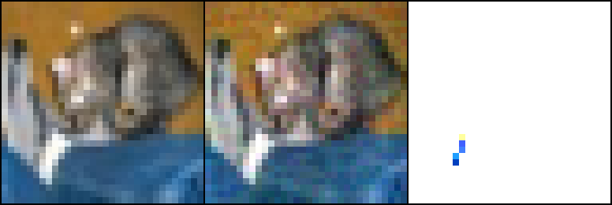

# Adversarial Robustness Lab

A hands-on experiment investigating how gradient-based adversarial
perturbations affect an image classifier.

## Current experiment

- Dataset: CIFAR-10.
- Model: a small convolutional neural network with 545,098 parameters.
- Training: 45,000 images, with 5,000 separate validation images.
- Evaluation: all 10,000 test images.
- Checkpoint: selected using the highest validation accuracy.
- Inputs: pixel values between 0 and 1.
- Constraint: maximum absolute change per pixel channel.
- Evaluations: Fast Gradient Sign Method, Projected Gradient Descent,
  and the standard AutoAttack suite.

During an attack, the model's weights remain fixed.
The attack modifies the input image to cause an incorrect prediction.

## Measured results

| Evaluation | Maximum pixel change | Test accuracy |
|---|---:|---:|
| Clean images | 0 | 70.29% |
| Fast Gradient Sign Method | 1/255 | 50.18% |
| Fast Gradient Sign Method | 2/255 | 33.98% |
| Fast Gradient Sign Method | 4/255 | 13.27% |
| Fast Gradient Sign Method | 8/255 | 1.54% |
| Projected Gradient Descent | 8/255 | 0.07% |
| AutoAttack standard suite | 8/255 | 0.06% |

All results above were measured using the same current checkpoint.
They supersede the earlier measurements.

At the same 8/255 limit:

- Fast Gradient Sign Method leaves 154 correct predictions.
- Projected Gradient Descent leaves 7 correct predictions.
- AutoAttack leaves 6 correct predictions.

These results demonstrate vulnerability under the tested settings.
They describe one model checkpoint and do not establish robustness
against every possible attack.

## Attack configurations

### Fast Gradient Sign Method

- Untargeted, white-box attack using the correct labels.
- One gradient-based step using cross-entropy loss.
- Evaluated at 0, 1/255, 2/255, 4/255, and 8/255.
- Pixel values clipped to the interval [0, 1].

### Projected Gradient Descent

- Untargeted, white-box attack using the correct labels.
- Cross-entropy loss.
- Maximum pixel-channel change: 8/255.
- Step size: 2/255.
- Steps: 20.
- One random starting point per image, with no additional restarts.
- Random seed: 42.
- Perturbation projected into the permitted region after every step.
- Pixel values clipped to the interval [0, 1].
- Attack success rate among initially correct images: 99.90%.

### AutoAttack

- Official implementation: https://github.com/fra31/auto-attack
- Standard suite: APGD-CE, APGD-T, FAB-T, and Square Attack.
- Maximum pixel-channel change: 8/255.
- Random seed: 42.
- Attack batch size: 50.
- Evaluated on all 10,000 test images.
- Clean accuracy: 70.29%.
- Accuracy surviving the suite: 0.06%.
- Attack success rate among initially correct images: 99.91%.

The model initially classified 7,029 test images correctly.
APGD-CE fooled 7,023 of those images. The remaining components
found no further successful attacks against the six survivors.

Surviving the suite does not prove that an image is robust.

The full evaluation report records this checkpoint SHA256:

```text
804dcdd45f32abade22306d8746c229ab3185b107cb7fb8086a10eb5c163801f
```

Attack success rate measures the fraction of originally correct
predictions that become incorrect after an attack.

## Example

An initially correct prediction changed from cat to dog under
Fast Gradient Sign Method at 8/255.

From left to right:

1. Original image.
2. Attacked image.
3. Absolute pixel differences magnified for visibility.



This example was selected because the attack succeeded.
The results table reports performance across all 10,000 test images.

## Run locally

The experiment was run on Windows using Python 3.11.9,
PyTorch 2.11.0+cu128, Torchvision 0.26.0+cu128,
and an NVIDIA GeForce RTX 4050 Laptop GPU.

The installation command below uses the CUDA 12.8 package index
for a compatible NVIDIA environment.

Create an environment and install the packages:

```powershell
py -3.11 -m venv .venv
.\.venv\Scripts\python.exe -m pip install torch==2.11.0 torchvision==0.26.0 --index-url https://download.pytorch.org/whl/cu128
.\.venv\Scripts\python.exe -m pip install git+https://github.com/fra31/auto-attack
```

The AutoAttack command installs the repository's current default
revision. The exact installed source revision has not yet been
recorded here.

Run the scripts in order:

```powershell
.\.venv\Scripts\python.exe check_gpu.py
.\.venv\Scripts\python.exe inspect_data.py
.\.venv\Scripts\python.exe train.py
.\.venv\Scripts\python.exe evaluate.py
.\.venv\Scripts\python.exe attack_fgsm.py
.\.venv\Scripts\python.exe visualize_attack.py
.\.venv\Scripts\python.exe evaluate_pgd.py
.\.venv\Scripts\python.exe evaluate_autoattack.py
```

The dataset downloads during the first inspection run.
Training creates the checkpoint needed by the evaluation scripts.

Use the same checkpoint for all evaluations in a comparison.
If you retrain, rerun every evaluation and refresh the example image.

Exact results may vary across environments.

## Project files

| File | Purpose |
|---|---|
| `check_gpu.py` | Verify graphics-card access |
| `inspect_data.py` | Load and inspect the dataset |
| `model.py` | Define the classifier |
| `train.py` | Train and save the best validation checkpoint |
| `evaluate.py` | Measure clean test accuracy |
| `attack_fgsm.py` | Implement and evaluate the single-step attack |
| `visualize_attack.py` | Save a selected successful attack example |
| `attack_pgd.py` | Implement the repeated-step attack |
| `evaluate_pgd.py` | Evaluate the repeated-step attack |
| `evaluate_autoattack.py` | Evaluate the standard AutoAttack suite |

## Saved outputs

- `reports/baseline.json`: clean test evaluation.
- `reports/fgsm.json`: single-step attack results.
- `reports/pgd.json`: repeated-step attack results and configuration.
- `reports/fgsm_example.png`: selected attack example.
- `reports/autoattack_trial.json`: preliminary 100-image evaluation.
- `reports/autoattack_trial.log`: preliminary evaluation log.
- `reports/autoattack_full.json`: full 10,000-image evaluation.
- `reports/autoattack_full.log`: full evaluation log.

The preliminary trial is separate from the full-test results.
It is not used in the main comparison table.

Datasets, local environments, and model checkpoints are excluded
from Git. Reproducing the experiment requires training a checkpoint.

## Limitations

- Results describe one small classifier and one current checkpoint.
- Training was not repeated across multiple random seeds.
- The original checkpoint is not distributed in this repository.
- No adversarial defense has been evaluated yet.
- Attack results are empirical measurements, not certified guarantees.

## Next experiments

- Adversarial training.
- Comparison of clean accuracy and accuracy under attack.
- Evaluation across multiple training seeds.